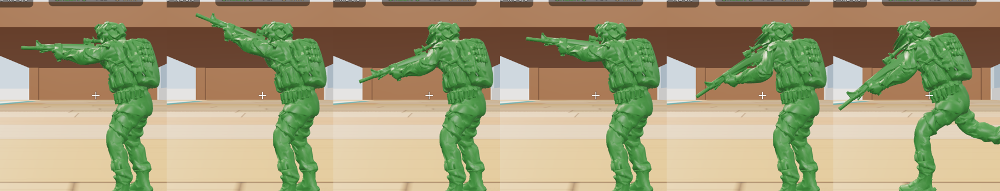

# Toy Soldiers

A first- and third-person shooter in the browser, built with three.js and the
Rapier physics engine. You are a 6 cm plastic soldier in a child's bedroom; the
toy chest has tipped over and its contents are the map.


## Run

```
npm install
npm run dev
```

Open the printed URL in a desktop browser and click to play.

## Controls

| Action | Keyboard / mouse | Gamepad |
|---|---|---|
| Move / look | WASD / mouse | Left stick / right stick |
| Fire / aim | Left click / right click | RT / LT |
| Jump, hold in the air for jetpack | Space | A |
| Sprint | Shift | L3 |
| Reload | R | X |
| Swap weapon | Q or mouse wheel | RB |
| Change loadout (next spawn) | 1 2 3 | D-pad left / right |
| Climb a rope | Walk into it, hold forward | Same |
| First / third person | V | Y |
| Day / night | N | D-pad up |
| Pause | Esc | Start |

## What is in this build

- Team deathmatch, 4 v 4: you and three green bots against four tan bots. First to 30 kills or the best score after 5 minutes wins.
- Bots that find their way around the map, hunt the other team, strafe and fire in bursts, and reload.
- Health that regenerates out of combat, 3-second respawns away from enemies, brief spawn protection, kill feed, scoreboard and result screen.
- The bedroom at real scale (4 m x 3.6 m), with bed, desk, window and the tipped toy chest.
- Map 01, hand-placed: alphabet blocks, building bricks, books, a ruler ramp, a pencil bridge, cars, crayons, a teddy bear, and knockable dominoes, marbles and a ball.
- One soldier controller shared by the player and bots, with first- and third-person cameras, jump and jetpack.
- Three loadouts, picked on the start screen or changed for the next spawn: Rifleman (Rifle), Scout (Scatter Gun) and Sharpshooter (scoped Long Shot), each with a Sidearm. Bots use them too.
- Weapons defined as data in `src/config.js`: damage, pellets, fire rate, spread, recoil, range falloff, zoom. Soldiers break into plastic pieces that melt.
- Three climbable ropes: a shoelace up the bed, a jump rope up the desk, twine up to the roof of the toy chest. The jetpack reaches the bed but not the desk.
- Synthesised sound: gunshots (positional for other soldiers), plastic shatter, hit marker, footsteps, reload, jetpack.
- Day and night lighting presets with a blend between them.
- A first-person view of the soldier's own arms and rifle with usable sights, drawn in its own pass so it never clips into walls.
- Start, pause and result screens. Pausing freezes the match and offers resume, restart and settings.
- Settings saved in the browser: bot difficulty, look sensitivity, invert look, field of view, volume, default camera, time of day, resolution, anti-aliasing (applies after a reload), shadow quality.
- Keyboard/mouse and gamepad input.

## Not built yet

- Grenades and unlocks.
- Bots using the jetpack or climbing; they stay on the floor.
- Different first-person and third-person models per weapon, a kneeling pose, and sourced models for the other toys.
- Multiplayer.
- The random-spill map generator.

## Soldier model and credits

Which figure the game uses is set by `soldier.model` in `src/config.js`. It is currently `pose40`: pose 40 of "US Soldier Set 05" by Dolphin-GS. That set is a paid asset, so its files are **not in this repository** (they are in `.gitignore`). Convert your own copy with the command in `public/models/soldier/CREDITS.txt`. If the files are absent, the game falls back to the freely licensed figure below.

The fallback, always present, is **"Modern Soldier Shooting Toy Soldier 3D Print" by nimproductions** ([CC BY 4.0](https://creativecommons.org/licenses/by/4.0/)); "Modern Soldier Relaxed" by the same artist is kept for comparison in the gallery. All credits are in `public/models/soldier/CREDITS.txt`.

`tools/stl2glb.mjs` converts a sculpt (STL or OBJ): it welds the mesh, recomputes normals, removes a moulded base if there is one, scales the figure to 6 cm, points its weapon forward, measures its joints and rifle, and writes a full-detail version and a 20,000-triangle game version.

The sculpt is a single rigid pose. To make it run, the converter measures where the hips, knees and ankles are, and the game gives the legs a small skeleton and skins the mesh to it (`src/entities/FigureSoldier.js`). Standing still, the figure is exactly the sculpt; moving, the legs stride. The rifle and both arms move as one piece from the shoulders: they follow the aim up and down, kick on each shot, dip to reload, and drop low across the body when sprinting. Soldiers still break into pieces and melt when shot.

First person shows the soldier's own arms and rifle, cut from the full-detail figure, so the view matches the toy. Every weapon therefore shows the figure's rifle; the weapons differ in how they fire.




To convert another figure: `node tools/stl2glb.mjs <file.stl or .obj> public/models/soldier/<name> --up z` (use `--up -z` if it comes out upside down), then set `soldier.model` to `<name>`.

Kenney's CC0 models (kenney.nl) are in `public/models/kenney/`, each pack with its `License.txt`.

## Model gallery

`npm run dev`, then open `/gallery.html` to compare models under the game's lighting: the soldier figure at full and game detail, the earlier code-built and Kenney soldier candidates, and Kenney's toy cars and blasters next to the current code-built ones. It is not part of the game.

## Performance

- Static geometry (the room and every toy that never moves) is merged into one mesh per material at load, and all alphabet-block faces share one texture. This took the frame from about 1,800 draw calls to about 170.
- Each soldier is three meshes instead of fifteen.
- Shadow maps refresh on alternate frames, and the lamp's only at night.
- Tracers and impact chips are two pooled instanced meshes, so a firefight adds no objects. A dying soldier's pieces share one material and cast no shadows.
- Weapon and shatter sounds are rendered into buffers once, then played back, instead of building a synth graph per shot.
- Route-finding is a weighted A* on typed arrays, limited to one search per frame across all bots.
- The simulation runs at most three catch-up steps per frame, and all shaders are compiled at load.
- Little garbage per frame, to avoid cleanup pauses: movement, raycasts, camera and input reuse scratch objects, and the physics step skips the library's per-step scan for engine-created bodies (unused here, and the largest single source of garbage).
- HUD bars and the damage vignette change only `transform` and `opacity`, and HUD text is rebuilt only when its values change.
- Resolution is automatic by default: it drops the pixel density when the frame rate falls below about 50 and raises it again when there is headroom. The HUD shows the current percentage.

## Layout

| Path | Purpose |
|---|---|
| `src/config.js` | Scale and all tuning numbers |
| `src/core/` | Input (keyboard, mouse, gamepad), saved settings, automatic resolution and the physics wrapper |
| `src/world/` | Room, toy factories, map 01 placement, static-mesh baking, lighting, materials |
| `src/entities/` | Soldier base class, the sculpted soldier figure (skeleton, run cycle, first-person view), player, bot |
| `tools/` | `stl2glb.mjs`, the STL-to-game-model converter, and `analyze.mjs`, which measures the figure's joints and rifle |
| `src/systems/` | Camera rig, weapon, combat, navigation grid, match rules, audio, effects |
| `src/ui/` | HUD and menus |

World units are centimetres.
