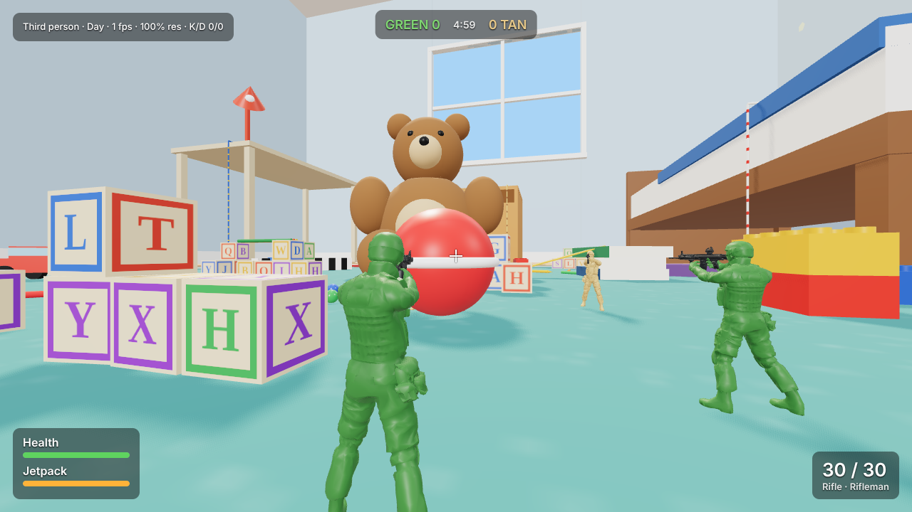
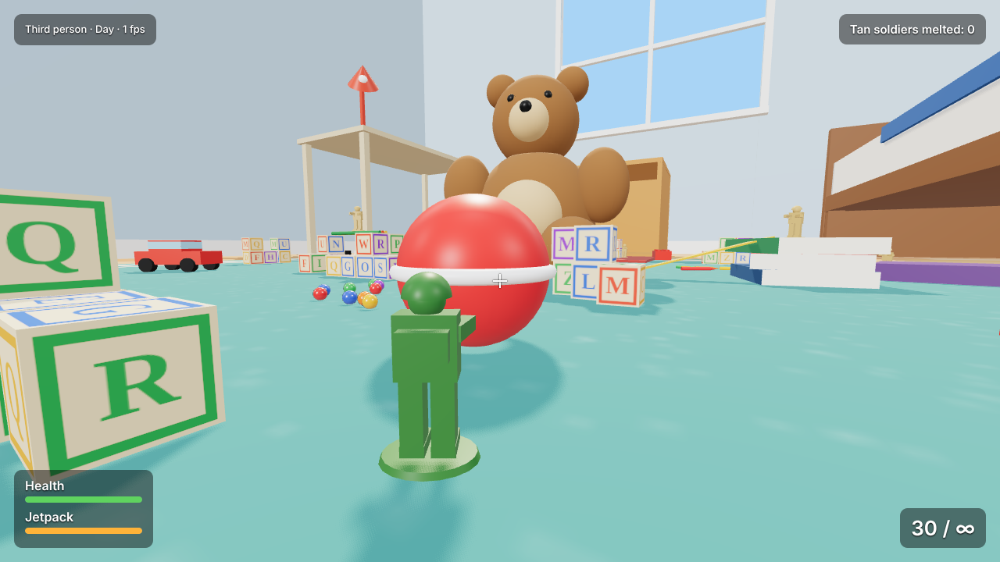
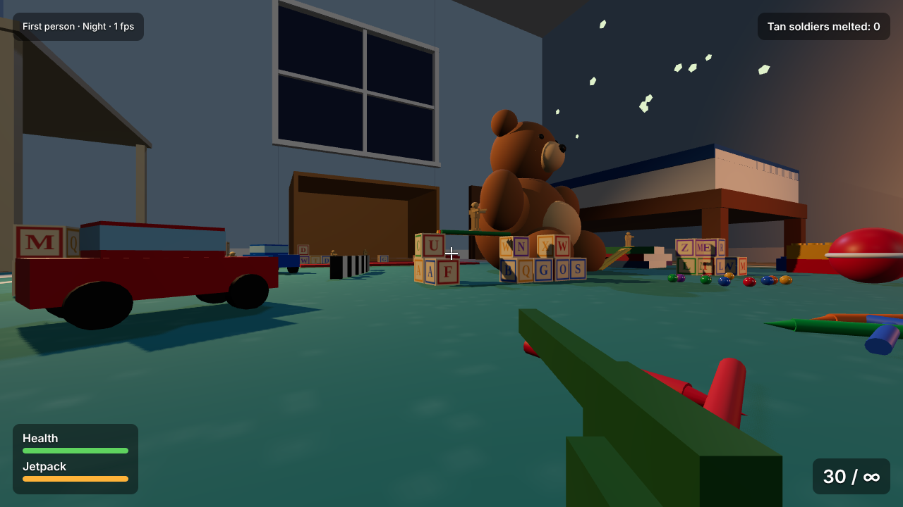
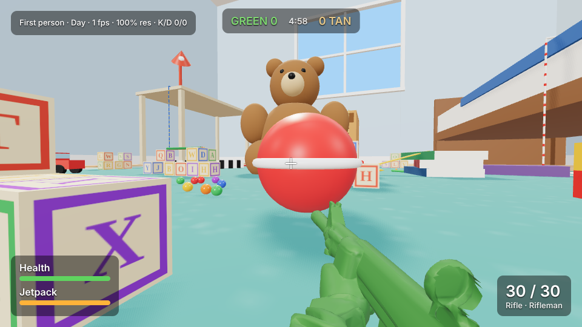
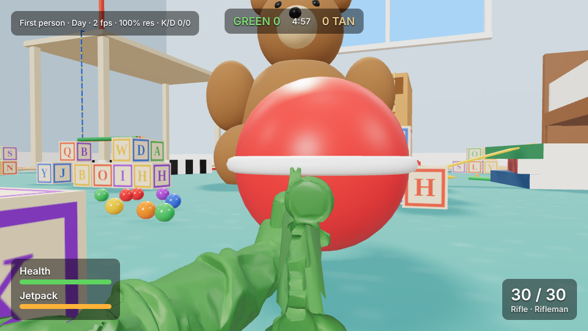
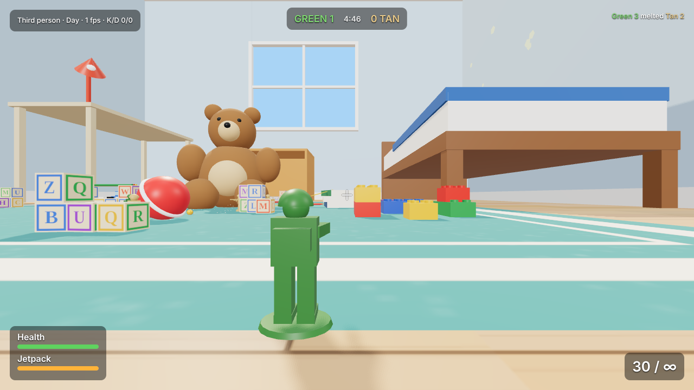
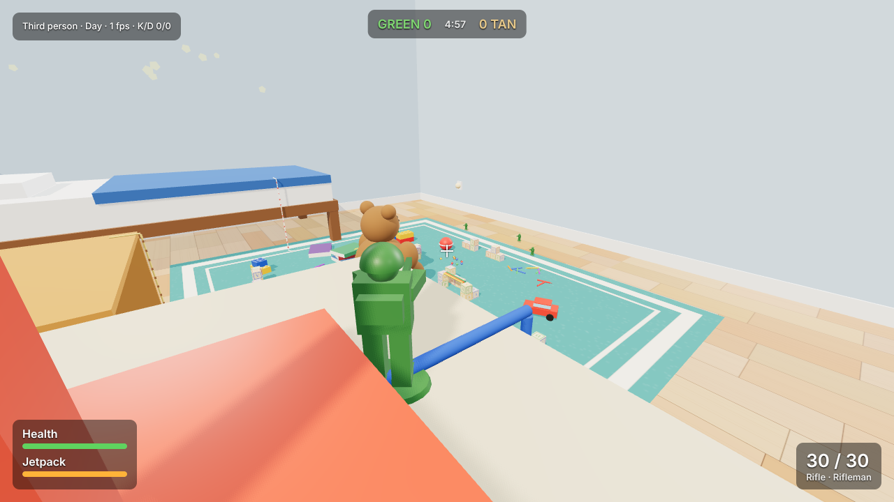
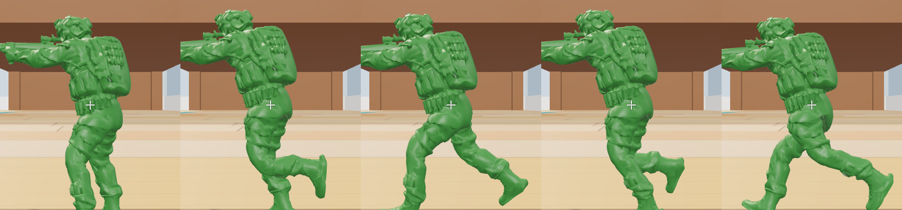
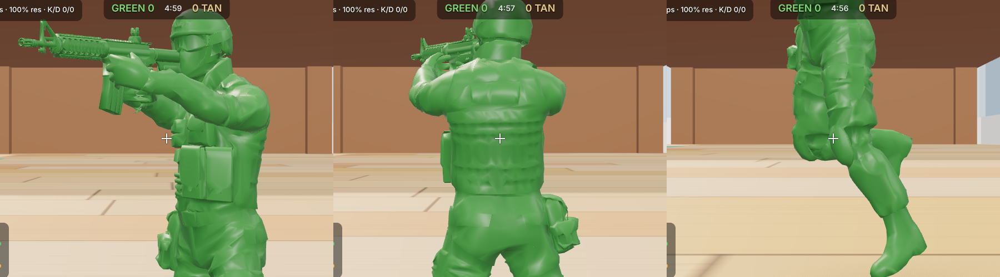
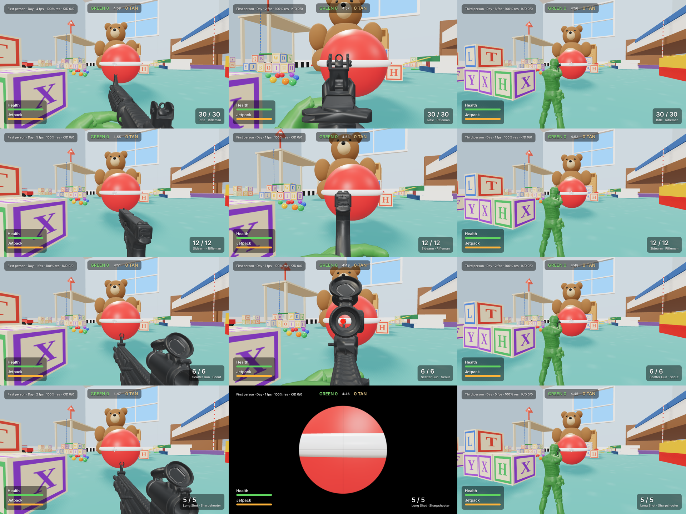

# Toy Soldiers

A first- and third-person shooter in the browser, built with three.js and the
Rapier physics engine. You are a 6 cm plastic soldier in a child's bedroom; the
toy chest has tipped over and its contents are the map.









## Run

```
npm install
npm run dev
```

Open the printed URL in a desktop browser and click to play.

## Controls

| Action | Keyboard / mouse | Gamepad |
|---|---|---|
| Move / look | WASD / mouse | Left stick / right stick |
| Fire / aim | Left click / right click | RT / LT |
| Jump, hold in the air for jetpack | Space | A |
| Sprint | Shift | L3 |
| Reload | R | X |
| Swap weapon | Q or mouse wheel | RB |
| Change loadout (next spawn) | 1 2 3 | D-pad left / right |
| Climb a rope | Walk into it, hold forward | Same |
| First / third person | V | Y |
| Day / night | N | D-pad up |
| Pause | Esc | Start |

## What is in this build

- Team deathmatch, 4 v 4: you and three green bots against four tan bots. First to 30 kills or the best score after 5 minutes wins.
- Bots that find their way around the map, hunt the other team, strafe and fire in bursts, and reload.
- Health that regenerates out of combat, 3-second respawns away from enemies, brief spawn protection, kill feed, scoreboard and result screen.
- The bedroom at real scale (4 m x 3.6 m), with bed, desk, window and the tipped toy chest.
- Map 01, hand-placed: alphabet blocks, building bricks, books, a ruler ramp, a pencil bridge, cars, crayons, a teddy bear, and knockable dominoes, marbles and a ball.
- One soldier controller shared by the player and bots, with first- and third-person cameras, jump and jetpack.
- Three loadouts, picked on the start screen or changed for the next spawn: Rifleman (Rifle), Scout (Scatter Gun) and Sharpshooter (scoped Long Shot), each with a Sidearm. Bots use them too.
- Weapons defined as data in `src/config.js`: damage, pellets, fire rate, spread, recoil, range falloff, zoom. Soldiers break into plastic pieces that melt.
- Three climbable ropes: a shoelace up the bed, a jump rope up the desk, twine up to the roof of the toy chest. The jetpack reaches the bed but not the desk.
- Synthesised sound: gunshots (positional for other soldiers), plastic shatter, hit marker, footsteps, reload, jetpack.
- Day and night lighting presets with a blend between them.
- A first-person view of the soldier's own arms and gun, aiming through its red-dot sight, drawn in its own pass so it never clips into walls.
- Start, pause and result screens. Pausing freezes the match and offers resume, restart and settings.
- Settings saved in the browser: bot difficulty, look sensitivity, invert look, field of view, volume, default camera, time of day, resolution, anti-aliasing (applies after a reload), shadow quality.
- Keyboard/mouse and gamepad input.

## Not built yet

- Grenades and unlocks.
- Bots using the jetpack or climbing; they stay on the floor.
- Gun models for the scatter gun and long shot (both show the Bren), a kneeling pose, and sourced models for the other toys.
- Multiplayer.
- The random-spill map generator.

## Soldier, guns and credits

The soldier is a gun-less character mesh with a skeleton, holding a separate gun model, so guns can be swapped per weapon.

- **Soldier**: the "genAssault" model supplied by the project owner (`assets-src/genAssault.c4d`). `tools/c4d2glb.mjs` reads the mesh and its levels of detail straight out of the Cinema 4D file and measures where the joints are.
- **Guns**: each weapon names its own gun model, and the soldier is seen holding whichever he is using. `tools/gun2glb.mjs` turns and scales a gun (`.glb` or `.obj`) and measures the points a soldier needs: both grips, the butt, the sight line and the muzzle.

  | Weapon | Gun | By |
  |---|---|---|
  | Rifle | M4A1 | mminhnghii02 |
  | Sidearm | Glock 19 | supplied by the project owner |
  | Scatter Gun, Long Shot | CZ Bren 2 (stand-in until they have their own) | Studio-Svoboda |

- **Skeleton and movement** are made in the game (`src/entities/RiggedSoldier.js`): 18 bones and skin weights computed from the measured joints. The torso blends by height and each limb along its own length, then the weights are relaxed across the mesh, so flat kit stays flat when he bends. Creases are darkened slightly per vertex so the one-colour plastic reads clearly.
- **Animation**: a keyframed run cycle (foot strike, push-off, knee drive) whose legs step in the direction of travel, forward, sideways or backward; the spine follows the aim; both arms are solved every frame to reach the gun's grips wherever the gun is (aiming, recoil, reload, sprint carry). Soldiers break into one piece per bone when shot.
- **First person** is a second copy of the player's soldier at full detail with the head hidden, seen from his eye, so it always matches what others see.

Guns are painted a separate dark plastic so they read against the hands (`soldier.gunColor` in `src/config.js`; set it to `null` for one-colour figures). A gun prepared with `--dot 1` gets a glowing red dot in its sight.

To add a gun: `node tools/gun2glb.mjs <gun.glb> public/models/guns/<name> --length <cm> --grip <material> --fore <material> --stock <material> --sight <material> --barrel <material>`, then set `model: '<name>'` on a weapon in `src/config.js`. A part can also be given as a region of the source model (`box:x0,y0,z0,x1,y1,z1`) when the gun has no separate part for it; `public/models/guns/CREDITS.txt` lists the sources.

Earlier static figures (nimproductions, CC BY 4.0; Dolphin-GS) are kept in `public/models/soldier/` for the gallery. All credits: `public/models/soldier/CREDITS.txt` and `public/models/guns/CREDITS.txt`. Kenney's CC0 models are in `public/models/kenney/`.





## Model gallery

`npm run dev`, then open `/gallery.html` to compare models under the game's lighting: the soldier figure at full and game detail, the earlier code-built and Kenney soldier candidates, and Kenney's toy cars and blasters next to the current code-built ones. It is not part of the game.

## Performance

- Static geometry (the room and every toy that never moves) is merged into one mesh per material at load, and all alphabet-block faces share one texture. This took the frame from about 1,800 draw calls to about 170.
- Each soldier is three meshes instead of fifteen.
- Shadow maps refresh on alternate frames, and the lamp's only at night.
- Tracers and impact chips are two pooled instanced meshes, so a firefight adds no objects. A dying soldier's pieces share one material and cast no shadows.
- Weapon and shatter sounds are rendered into buffers once, then played back, instead of building a synth graph per shot.
- Route-finding is a weighted A* on typed arrays, limited to one search per frame across all bots.
- The simulation runs at most three catch-up steps per frame, and all shaders are compiled at load.
- Little garbage per frame, to avoid cleanup pauses: movement, raycasts, camera and input reuse scratch objects, and the physics step skips the library's per-step scan for engine-created bodies (unused here, and the largest single source of garbage).
- HUD bars and the damage vignette change only `transform` and `opacity`, and HUD text is rebuilt only when its values change.
- Resolution is automatic by default: it drops the pixel density when the frame rate falls below about 50 and raises it again when there is headroom. The HUD shows the current percentage.

## Layout

| Path | Purpose |
|---|---|
| `src/config.js` | Scale and all tuning numbers |
| `src/core/` | Input (keyboard, mouse, gamepad), saved settings, automatic resolution and the physics wrapper |
| `src/world/` | Room, toy factories, map 01 placement, static-mesh baking, lighting, materials |
| `src/entities/` | Soldier base class, the rigged soldier (skeleton, skinning, posing, gun holding), player, bot |
| `tools/` | Asset converters: `c4d2glb.mjs` (soldier from Cinema 4D), `gun2glb.mjs` (guns), `stl2glb.mjs` (static sculpts) |
| `assets-src/` | The original model files the converters read |
| `src/systems/` | Camera rig, weapon, combat, navigation grid, match rules, audio, effects |
| `src/ui/` | HUD and menus |

World units are centimetres.
